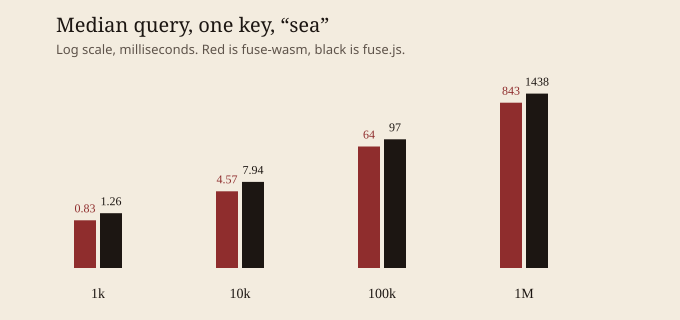

# fuse-wasm benchmarks

Node v22.14.0, fuse.js 7.5.0, one process. Times are milliseconds. `js/wasm` above 1 means fuse-wasm is faster. Heap is the delta in `process.memoryUsage().heapUsed` across index construction, so it includes JS objects as well as the WASM heap.

Queries were faster in every full-size case below. The gains are modest on a short query against one key (about 1.5× at 1,000 and 100,000 records) and larger when there are five keys or the pattern is long enough for the exact character prefilter to reject a record. That long-pattern gap is not a different score: both engines return no hits for `abcdefghijklmnopqrstuvwxyz0123456789extra` against these titles, and fuse.js still walks Bitap.

Index construction is the slow path. Copying normalized UTF-16 into the WASM heap costs more than Fuse's own index. At 1,000 one-key records the index was 8.4 ms versus 2.4 ms. At 1,000,000 it was 29.1 s versus 0.56 s, one sample, with a noisy heap because garbage collection ran mid-measurement (negative heap deltas in the table). The 1,000,000-record p95 is one bad sample out of three.

A separate 21-iteration check on tiny lists, same one-key short query, did not find a size where queries were slower. 200 records tied (0.116 ms vs 0.117 ms). 20 records was still faster (0.024 ms vs 0.068 ms).

One-key short query, median:

- 1,000 records: 1.52× (0.83 ms vs 1.26 ms)
- 10,000 records: 1.74× (4.57 ms vs 7.94 ms)
- 100,000 records: 1.53× (63.79 ms vs 97.49 ms) — under the 3× hope for this shape
- 100,000 records, five keys, medium query: 4.53× (192 ms vs 870 ms)
- 1,000,000 records: 1.71× (843 ms vs 1,438 ms)

| Case | n | keys | wasm median | wasm p95 | js median | js p95 | wasm qps | js qps | wasm index | js index | wasm heap MB | js heap MB | js/wasm |
| --- | ---: | ---: | ---: | ---: | ---: | ---: | ---: | ---: | ---: | ---: | ---: | ---: | ---: |
| 1000 · 1 key · short | 1000 | 1 | 0.83 | 1.49 | 1.26 | 4.34 | 1204.9 | 795.2 | 8.36 | 2.42 | 0.6 | 0.7 | 1.52 |
| 1000 · 1 key · medium | 1000 | 1 | 0.52 | 1.06 | 0.62 | 1.59 | 1910.9 | 1616.0 | 2.37 | 1.45 | 1.3 | 0.6 | 1.18 |
| 1000 · 1 key · long | 1000 | 1 | 0.11 | 0.11 | 21.35 | 23.68 | 9290.0 | 46.8 | 1.19 | 0.31 | 1.2 | 0.6 | 198.32 |
| 1000 · 5 key · short | 1000 | 5 | 1.07 | 1.20 | 3.73 | 6.33 | 933.2 | 267.9 | 7.59 | 4.62 | -2.6 | -4.0 | 3.48 |
| 1000 · 5 key · medium | 1000 | 5 | 1.62 | 1.73 | 8.15 | 9.28 | 615.9 | 122.7 | 4.51 | 1.65 | -10.5 | 2.4 | 5.02 |
| 1000 · 5 key · long | 1000 | 5 | 5.12 | 5.21 | 106.53 | 120.03 | 195.4 | 9.4 | 3.64 | 0.97 | 4.2 | 2.2 | 20.82 |
| 1000 · 1 key · short · matches | 1000 | 1 | 0.92 | 2.32 | 1.28 | 5.25 | 1088.3 | 782.2 | 1.99 | 0.29 | 1.2 | 0.6 | 1.39 |
| 1000 · 1 key · short · extended | 1000 | 1 | 0.29 | 0.34 | 0.55 | 1.31 | 3486.3 | 1826.6 | 1.00 | 0.32 | 1.2 | 0.6 | 1.91 |
| 10000 · 1 key · short | 10000 | 1 | 4.57 | 6.98 | 7.94 | 8.52 | 218.8 | 125.9 | 11.09 | 3.85 | -2.1 | -7.5 | 1.74 |
| 10000 · 1 key · medium | 10000 | 1 | 5.29 | 9.11 | 8.40 | 10.26 | 189.0 | 119.1 | 11.82 | 5.67 | -1.7 | 6.4 | 1.59 |
| 10000 · 1 key · long | 10000 | 1 | 1.05 | 1.74 | 209.95 | 211.36 | 956.6 | 4.8 | 12.16 | 2.24 | 3.2 | 5.8 | 200.84 |
| 10000 · 5 key · short | 10000 | 5 | 10.78 | 13.95 | 30.67 | 42.48 | 92.7 | 32.6 | 49.59 | 15.68 | 9.5 | 10.6 | 2.84 |
| 10000 · 5 key · medium | 10000 | 5 | 17.48 | 19.31 | 85.32 | 87.81 | 57.2 | 11.7 | 40.17 | 12.08 | 11.6 | 10.1 | 4.88 |
| 10000 · 5 key · long | 10000 | 5 | 69.00 | 85.37 | 1060.77 | 1090.12 | 14.5 | 0.9 | 45.54 | 13.70 | -105.3 | 11.4 | 15.37 |
| 10000 · 1 key · short · matches | 10000 | 1 | 8.37 | 10.59 | 10.48 | 12.02 | 119.5 | 95.4 | 10.82 | 1.93 | -1.7 | 5.8 | 1.25 |
| 10000 · 1 key · short · extended | 10000 | 1 | 2.85 | 3.58 | 3.19 | 5.28 | 350.7 | 313.0 | 18.94 | 3.54 | -95.4 | -7.4 | 1.12 |
| 100000 · 1 key · short | 100000 | 1 | 63.79 | 114.64 | 97.49 | 175.22 | 15.7 | 10.3 | 175.97 | 53.61 | 17.6 | 31.5 | 1.53 |
| 100000 · 1 key · medium | 100000 | 1 | 65.50 | 85.23 | 105.30 | 141.28 | 15.3 | 9.5 | 140.52 | 40.79 | 42.3 | 31.5 | 1.61 |
| 100000 · 1 key · long | 100000 | 1 | 10.48 | 16.40 | 2165.82 | 2201.09 | 95.4 | 0.5 | 130.09 | 37.89 | 54.9 | 30.9 | 206.61 |
| 100000 · 5 key · short | 100000 | 5 | 126.69 | 176.70 | 340.94 | 352.39 | 7.9 | 2.9 | 2859.67 | 118.46 | 66.9 | 64.2 | 2.69 |
| 100000 · 5 key · medium | 100000 | 5 | 192.18 | 194.60 | 870.26 | 953.54 | 5.2 | 1.1 | 515.56 | 125.21 | 80.4 | 77.3 | 4.53 |
| 100000 · 5 key · long | 100000 | 5 | 824.55 | 832.51 | 10605.14 | 10823.00 | 1.2 | 0.1 | 439.35 | 146.69 | 102.0 | 75.7 | 12.86 |
| 100000 · 1 key · short · matches | 100000 | 1 | 135.70 | 185.17 | 165.86 | 210.35 | 7.4 | 6.0 | 152.24 | 51.29 | 43.1 | 30.1 | 1.22 |
| 100000 · 1 key · short · extended | 100000 | 1 | 47.38 | 92.21 | 79.33 | 151.56 | 21.1 | 12.6 | 161.64 | 53.85 | -411.0 | 20.4 | 1.67 |
| 1000000 · 1 key · short | 1000000 | 1 | 842.68 | 36688.55 | 1438.28 | 1754.27 | 1.2 | 0.7 | 29149.51 | 564.41 | 143.8 | 298.8 | 1.71 |
| 1000000 · 1 key · long | 1000000 | 1 | 105.92 | 106.69 | 21555.11 | 21768.80 | 9.4 | 0.0 | 2211.08 | 453.66 | -1424.9 | 301.1 | 203.51 |
